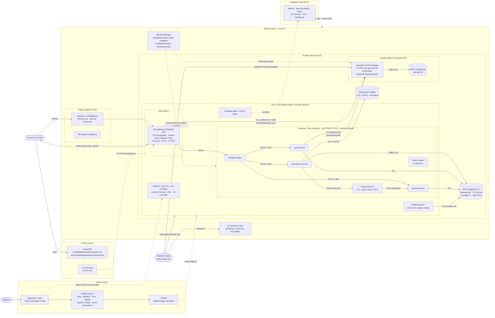

# Environment architecture (as deployed)

The deployed AWS environment in `eu-west-2`, as built by [`infra/`](../infra) and
[`deploy/`](../deploy). It differs from the [target architecture](architecture.md) where
noted under *Deviations*. Evidence for every control is in [`docs/evidence/`](evidence).

## Trust boundaries

| # | Boundary | Crossing | Control |
|---|---|---|---|
| 1 | Internet → AWS | Customer HTTPS | NLB exposes 80/443 only; WAF; rate limit; TLS 1.2+ (Let's Encrypt); HTTP redirected |
| 2 | Edge → services | Gateway → frontend → APIs | Istio STRICT mTLS, AuthorizationPolicy per workload identity, NetworkPolicy, JWT validation in every API |
| 3 | EKS → identity platform | Gateway / user-service → Keycloak | Separate ECS cluster and security group (8443 from EKS nodes only); TLS verified against a private CA and an exact SAN |
| 4 | Services → data | APIs → RDS, Valkey, Kafka | Per-service DB roles with minimal grants; TLS required; Valkey AUTH; Kafka client certificates + ACLs; security groups allow EKS nodes only |
| 5 | Workloads → secrets | External Secrets / ECS → Secrets Manager | Pod Identity role scoped to `techbleat/cluster/*`; Keycloak's execution role scoped to `techbleat/identity/*` |
| 6 | Delivery → cluster | Git → Argo CD | Only `main` deploys; manual changes reverted (self-heal); images by signed digest; two Argo CD projects separate platform from app |
| 7 | Operator → control planes | Laptop → EKS API, ECS, AWS | EKS API restricted to one IP; Keycloak admin only via SSM; no public admin UIs |
| 8 | Cluster → SaaS | Agent → Datadog | Outbound HTTPS only; logs scrubbed at the Agent; AWS metrics through a read-only role with an external ID |

## Data classification

| Data | Class | Where it lives | Handled by |
|---|---|---|---|
| Passwords | Credential (secret) | Keycloak (hashed) | Browser → Keycloak; user-service only in transit at registration (never stored or logged) |
| Access tokens (JWT) | Credential (short-lived, 5 min) | Browser memory | Frontend, APIs (validated, never logged), FinanceAgent (forwarded) |
| Client secrets, DB/Valkey passwords, Datadog key | Secret | Secrets Manager; Kubernetes Secrets (encrypted with KMS) | External Secrets, workloads, ECS |
| Names, emails, user IDs | Personal data | Banking DB, Keycloak DB | user-service, Keycloak |
| Balances, accounts | Financial (account data) | Banking DB, Valkey (balance cache) | transaction-service |
| Transactions, activity events | Financial (transaction data) | Banking DB, Kafka (transient) | transaction-service, activity-service |
| Telemetry | Operational (scrubbed) | Datadog EU | Agent |

## Deviations from the target architecture

| Target | Deployed | Reason / mitigation |
|---|---|---|
| Cloudflare (DNS, WAF, DDoS, rate limit) | DuckDNS + AWS NLB (Shield Standard) + Coraza WAF and rate limit at the Istio gateway | DuckDNS subdomains cannot be delegated to Cloudflare |
| Managed Kafka | In-cluster Strimzi, hardened (TLS-only, client certs, ACLs, NetworkPolicy, encrypted disk) | Session cost and create/destroy time; single broker is a sandbox limitation |
| Backstage | Not implemented | Developer portal is out of scope for the security deployment |
| Persistent environment | Ephemeral: built and destroyed per session | Cost control; data does not survive `down` (production would keep it, with deletion protection and cross-region backups) |
| Multi-AZ data services | Single-AZ RDS / Valkey, single NAT gateway | Sandbox cost; documented production recommendation |
